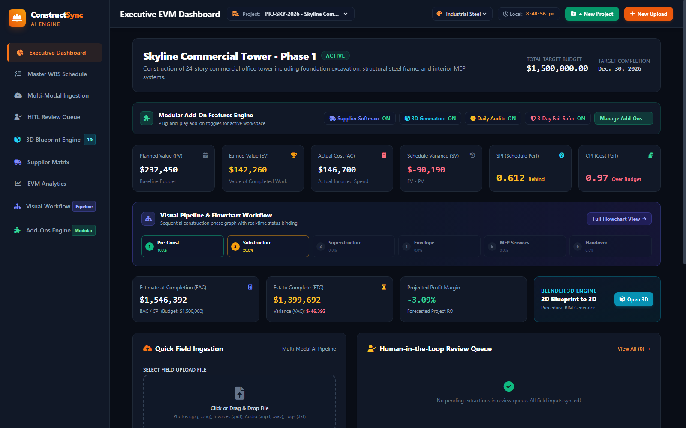
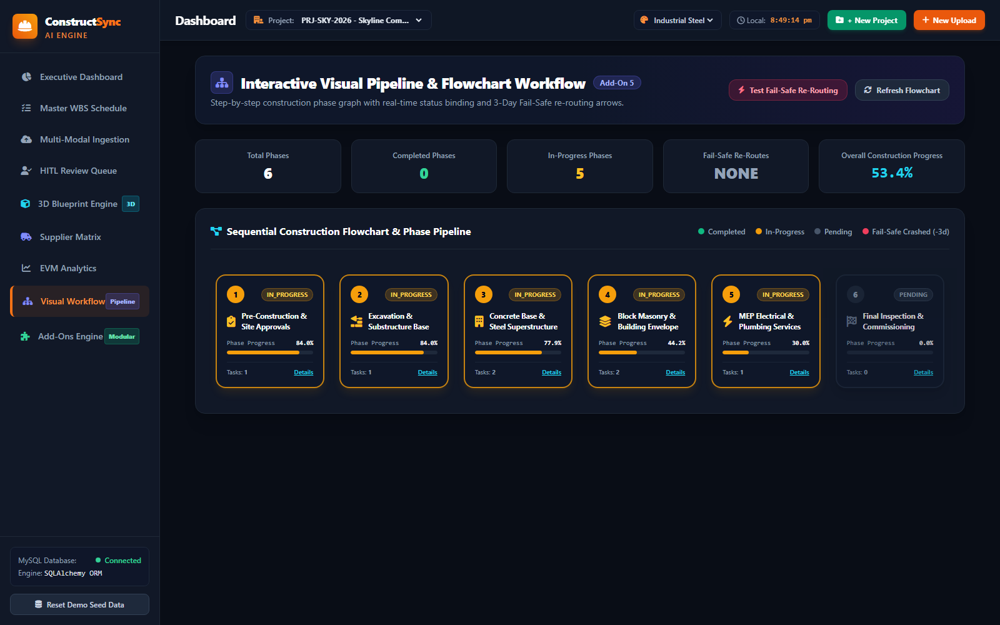
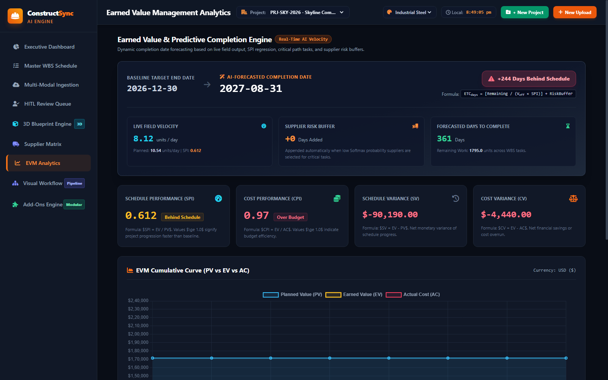
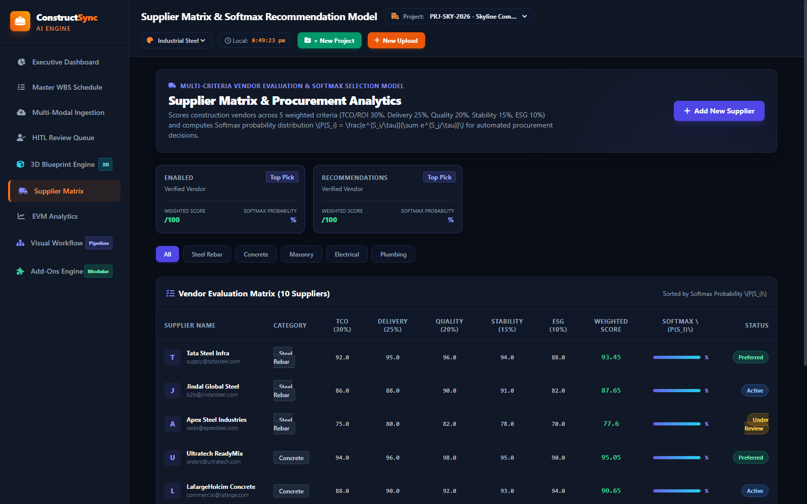
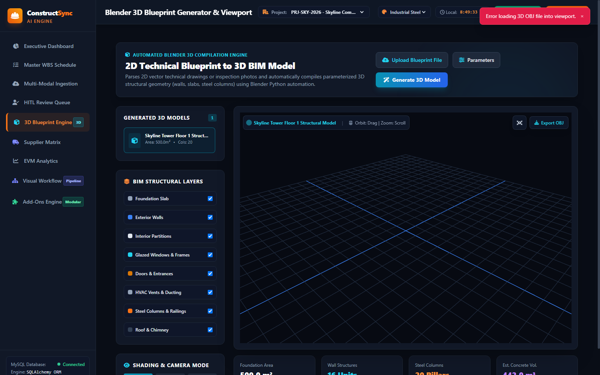
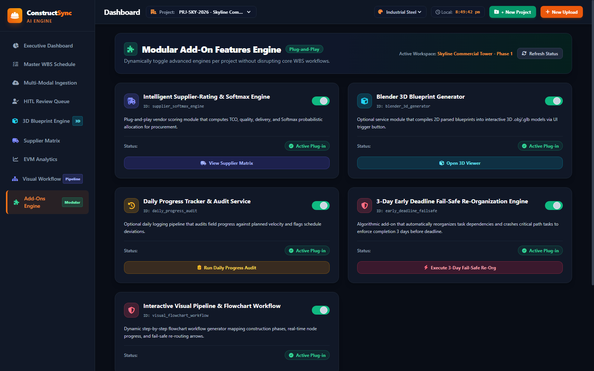

# ConstructFlow AI — Minimum Viable Product (MVP) Specification & Architecture Manual

**ConstructFlow AI** (also known as *ConstructSync AI*) is an enterprise-grade AI-powered Autonomous Construction Project Management Platform. Built on Python (Django), MySQL/SQLite, Tailwind CSS, and HTML5, the system integrates Earned Value Management (EVM), multi-modal field ingestion, intelligent vendor selection, 3D BIM procedural generation, interactive phase-dependency graph flowcharts, and automated fail-safe schedule recovery into a plug-and-play modular architecture.

---

## 1. Executive Summary & Core Value Proposition

Modern construction projects frequently experience budget overruns, delayed material deliveries, and schedule slippage caused by fragmented site reporting and static project management tools. **ConstructFlow AI** addresses these challenges by transforming raw site data (photos, invoices, dictation audio, daily logs) into actionable predictive intelligence.

> **Modular Architecture**: All advanced engines operate as **modular add-ons**. Any advanced system (e.g., 3D Blender Converter, Softmax Supplier Engine, 3-Day Fail-Safe Engine) can be dynamically toggled ON or OFF via backend feature flags without breaking core project workflows or causing database schema errors.

---

## 2. Interface Screenshots & UI Walkthrough

Below are real application screenshots captured directly from the live ConstructFlow AI platform:

### 2.1 Executive Dashboard
Overview of project KPIs, Planned Value (PV), Earned Value (EV), Actual Cost (AC), Schedule Variance (SV), SPI/CPI performance gauges, multi-modal ingestion dropzone, and active modular add-on status badges.



---

### 2.2 Interactive Visual Pipeline & Flowchart Workflow
Dynamic step-by-step construction phase graph (`Pre-Construction` -> `Substructure` -> `Superstructure` -> `Envelope` -> `MEP Services` -> `Handover`). Binds real-time field log completion percentages and task statuses into the interactive flow graph.



---

### 2.3 Real-Time AI Predictive Completion Engine & EVM Analytics
Calculates live field velocity (\(V_{actual}\)), remaining forecast days, baseline velocity fallback guards, supplier risk buffers (+3 to +10 days), and projected completion dates.



---

### 2.4 Intelligent Supplier-Rating Softmax Procurement Engine
Multi-criteria vendor evaluation matrix (TCO 30%, Delivery 25%, Quality 20%, Stability 15%, ESG 10%) with Softmax probability distributions to select optimal suppliers per material category.



---

### 2.5 2D Blueprint to 3D Procedural BIM Engine
Converts 2D architectural blueprints into 3D Wavefront `.obj` mesh structures with Three.js procedural rendering, camera orbit tools, and quantity takeoffs.



---

### 2.6 Modular Add-On Features Manager
Backend feature toggle control center enabling real-time injection or decoupling of advanced engines without system downtime or database conflicts.



---

## 3. Key Add-On Engines & Technical Features

### 3.1 Multi-Modal Field Ingestion Engine
- **Supported File Types**: Site Inspection Photos (`.jpg`, `.png`), Vendor Invoices & Delivery Receipts (`.pdf`), Inspector Voice Dictation (`.mp3`, `.wav`), Daily Site Logs (`.txt`).
- **Processing Flow**:
  1. Uploaded files are received by `POST /api/upload`.
  2. OCR / Speech-to-Text / Vision parsing extracts physical work quantities (e.g., "Poured 45 cu.m ready-mix concrete").
  3. Mapped metrics are pushed into a **Human-in-the-Loop Review Queue** for engineer verification before updating EVM actuals.

### 3.2 Intelligent Supplier-Rating Softmax Engine
- **Multi-Criteria Evaluation**: Scores vendors across 5 weighted criteria.
- **Softmax Probability Model**:
  \[ P(S_i) = \frac{e^{S_i / \tau}}{\sum_{j} e^{S_j / \tau}} \]
  Computes probabilistic vendor rankings to eliminate procurement bias and automatically recommend top suppliers per material category.

### 3.3 2D Blueprint to 3D Procedural BIM Engine
- Converts 2D architectural blueprint files into 3D Wavefront `.obj` mesh files and Three.js-renderable 3D structural scenes.
- Procedurally builds foundation footings, structural columns, beams, floor slabs, and exterior envelopes with interactive orbit, pan, and zoom controls.

### 3.4 Interactive Visual Pipeline & Flowchart Workflow
- Renders dynamic step-by-step construction phase graphs (`Pre-Construction` -> `Substructure` -> `Superstructure` -> `Envelope` -> `MEP Services` -> `Handover`).
- Automatically updates node completion percentages, active task statuses, and dependency edge states in real-time as field logs are approved.

### 3.5 Real-Time AI Predictive Completion Engine & EVM Analytics
- **Live Field Velocity (\(V_{actual}\))**: Tracks actual daily work velocity (\(\text{units / day}\)).
- **Baseline Fallback Guard**: When no field logs exist (\(V_{actual} = 0.0\)), the system falls back to baseline planned velocity (\(V_{planned} \times \text{SPI}\)) to prevent forecast date explosion.
- **Supplier Risk Buffer**: Evaluates critical-path vendor scores. If a critical task is assigned to a vendor with Softmax probability \(< 25\%\), appends a \(+3\) to \(+10\) day schedule risk buffer.
- **Forecast Formula**:
  \[ \text{ETC}_{\text{days}} = \frac{\text{Remaining Work}}{V_{\text{effective}} \times \text{SPI}} + \text{Supplier Risk Buffer} \]

### 3.6 3-Day Early Deadline Fail-Safe Re-Organization Mechanism
- Automatically detects critical path delays exceeding 3 days.
- Triggers non-destructive schedule compression: reallocates floating resources, adjusts downstream task target start dates, and updates the visual flowchart timeline in real-time.

### 3.7 Project-Scoped NoSQL Document Storage
- Stores unstructured project files, invoice PDFs, site photos, dictations, and generated 3D models into project-isolated document tables (`nosql_<project_code>`) for high-throughput JSON document querying.

---

## 4. REST API Endpoint Reference

| Method | Endpoint | Description | Request Body / Parameters |
| :--- | :--- | :--- | :--- |
| `POST` | `/api/upload` | Upload multi-modal field ingestion file | `multipart/form-data`: `file`, `notes`, `project_id` |
| `GET` | `/api/predictive-forecast` | Retrieve real-time AI completion forecast | Query param: `project_id` |
| `POST` | `/api/flowchart/rebuild` | Trigger visual flowchart graph regeneration | JSON: `{"project_id": 1}` |
| `GET` | `/api/supplier-scores` | Get Softmax probabilities & vendor rankings | Query param: `category` |
| `POST` | `/api/generate-3d-blueprint` | Generate 3D procedural BIM mesh from blueprint | JSON: `{"blueprint_id": 1}` |
| `POST` | `/api/toggle-addon` | Dynamically toggle modular add-on engines | JSON: `{"addon_key": "early_deadline_failsafe", "enabled": true}` |
| `GET` | `/api/nosql/query` | Query project-scoped NoSQL document table | Query params: `project_name`, `file_type` |

---

## 5. Local & Docker Container Deployment Guide

### Local Running Instructions
1. Install Python dependencies:
   ```bash
   pip install -r requirements.txt
   ```
2. Initialize database and seed demo project data:
   ```bash
   python manage.py migrate
   python seed.py
   ```
3. Start the application:
   ```bash
   python app.py
   ```
4. Access the web interface at **`http://localhost:5000`**.

### Docker Container Deployment (`SIH_2026`)
Build and launch the containerized application using Docker Compose:
```bash
docker compose up --build -d
```
Alternatively, build and run via Docker CLI:
```bash
docker build -t sih_2026:latest .
docker run -d --name SIH_2026 -p 5000:5000 sih_2026:latest
```
